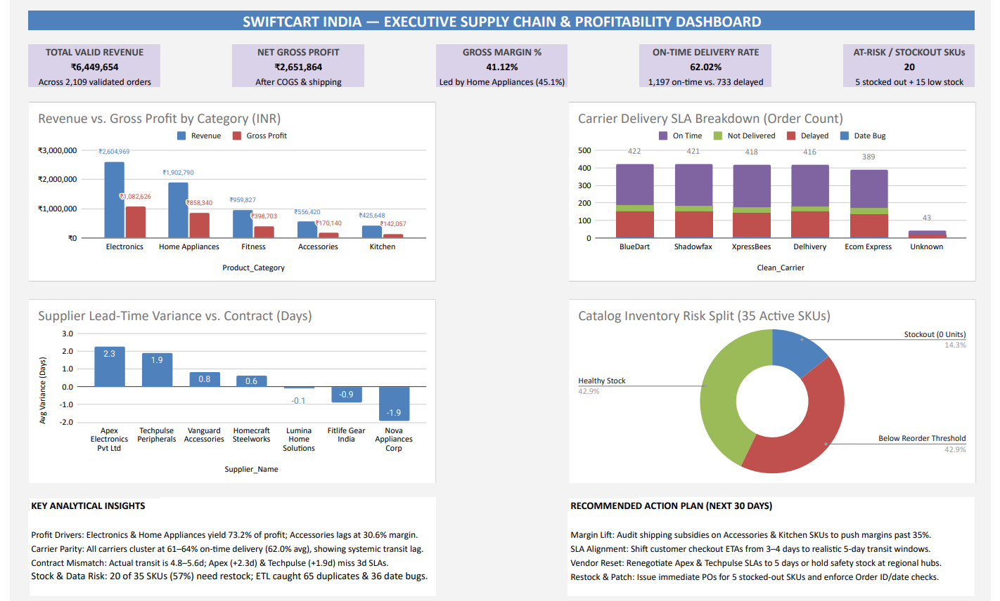
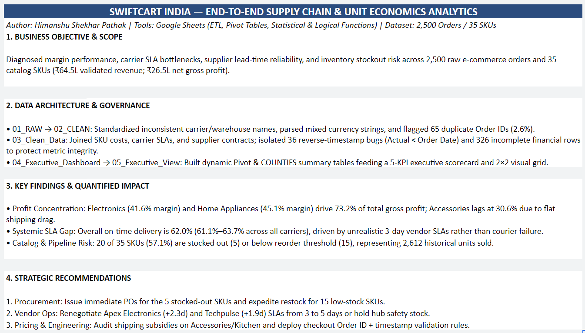

# 📦 SwiftCart India — Supply Chain & Unit Economics Analytics

🔗 **[View Live Interactive Google Sheets Dashboard](https://docs.google.com/spreadsheets/d/1H4gXoDPzkxvN8meUmz0fTOJwDxTpmlwtTs94QS48_uE/edit?gid=1769924726#gid=1769924726)** | 📄 **[Download 1-Page Executive PDF](dashboard/SwiftCart_Executive_Report.pdf)**

---

## 📌 Executive Overview
An end-to-end e-commerce supply chain, logistics SLA, and unit economics case study analyzing **2,500+ raw order records** across **35 active SKUs** for **SwiftCart India**. Built entirely in **Google Sheets**, this project transforms messy operational logs into a reconciled data pipeline, automated KPI scorecard, and 30-day executive action plan.

---

## 📊 Executive Dashboard Preview


---

## 🔍 Key Analytical Insights & Business Impact
* **Profit Concentration & Margin Drag:** Electronics (`41.6%` margin) and Home Appliances (`45.1%` margin) generate **73.2%** of total net gross profit (`₹26.5L` across `₹64.5L` validated revenue), whereas Accessories lags at **30.6%** due to flat-rate shipping subsidies.
* **Systemic Delivery Bottleneck:** All five logistics partners cluster tightly between **61.1% and 63.7%** on-time delivery (`62.02%` overall), proving that delays stem from aggressive checkout transit promises rather than single-carrier failure.
* **Vendor SLA Mismatch:** Actual supplier delivery times average **4.8–5.6 days** across all vendors; Apex Electronics (`+2.3d` variance) and Techpulse Peripherals (`+1.9d` variance) miss targets primarily due to unrealistic 3-day contractual SLAs.
* **Inventory & Data Pipeline Risk:** **20 of 35 SKUs (`57.1%`)** are either stocked out (`5`) or below reorder threshold (`15`), while automated ETL validation isolated **427 anomalous records** (`65` duplicate orders, `36` reverse-timestamp bugs, and `326` incomplete financial rows).

---

## 🚀 Recommended Action Plan (Next 30 Days)
1. **Immediate Inventory Replenishment:** Issue emergency Purchase Orders for the **5 stocked-out SKUs** and expedite restocking for the **15 low-stock SKUs** to prevent lost revenue.
2. **Vendor SLA Renegotiation:** Recalibrate Apex Electronics and Techpulse contracts from 3-day to realistic **5-day SLAs**, or establish regional safety stock at Bengaluru and Hyderabad hubs.
3. **Shipping Subsidy & Checkout Audit:** Review flat-rate shipping tiers on low-margin Accessories and Kitchen SKUs to lift category margins above **35%**, and align customer delivery ETAs with 5-day transit benchmarks.
4. **Ingestion Validation Patch:** Enforce unique `Order_ID` constraints and timestamp logic checks (`Delivery_Date >= Order_Date`) at checkout/warehouse ingestion.

---

## 🗺️ Project Architecture & Governance


1. **`01_RAW_Orders_DO_NOT_EDIT` & Lookup Tables:** Immutable raw order logs, SKU master catalog, carrier SLAs, warehouse mappings, and supplier contracts.
2. **`02_CLEAN_Orders` (Staging):** Standardized inconsistent carrier/warehouse naming conventions, parsed mixed currency formats, and flagged duplicate `Order_ID` entries.
3. **`03_Clean_Data` (Master Model):** Joined unit COGS, shipping rates, and vendor SLAs; isolated reverse-timestamp anomalies and incomplete financial rows from KPI aggregations.
4. **`04_Executive_Dashboard` (Analytics Engine):** Dynamic Pivot Tables, `COUNTIFS`, and reconciliation checks powering unit economics, SLA compliance, and stock-risk splits.
5. **`05_Executive_View` & `00_Project_Overview`:** Executive presentation layer featuring a 5-KPI scorecard, 2×2 visual grid, and governance documentation.

---

## 🛠️ Tech Stack & Competencies
* **Google Sheets:** Multi-stage ETL modeling, `INDEX/MATCH` & `XLOOKUP` relational joins, `COUNTIFS`/`SUMIFS`, Dynamic Pivot Tables, Data Validation, and Executive Dashboard UI Design.
* **Domain Analytics:** Unit Economics & Gross Margin Analysis, Logistics SLA Benchmarking, Supplier Lead-Time Variance, and Inventory Reorder Point Modeling.

---

## 📁 Repository Structure
```text
├── dashboard/
│   ├── SwiftCart_Executive_Report.pdf      # High-resolution single-page PDF export
│   └── SwiftCart_Analytics_Workbook.xlsx   # Full Excel backup with formulas & pivots
├── data/
│   ├── raw/                                # Unmodified source CSV datasets
│   └── processed/                          # Cleaned, reconciled analytical tables
├── images/
│   ├── 01_executive_dashboard.png          # Executive KPI & 4-chart dashboard view
│   └── 02_project_overview.png             # Project architecture & governance cover
└── README.md
